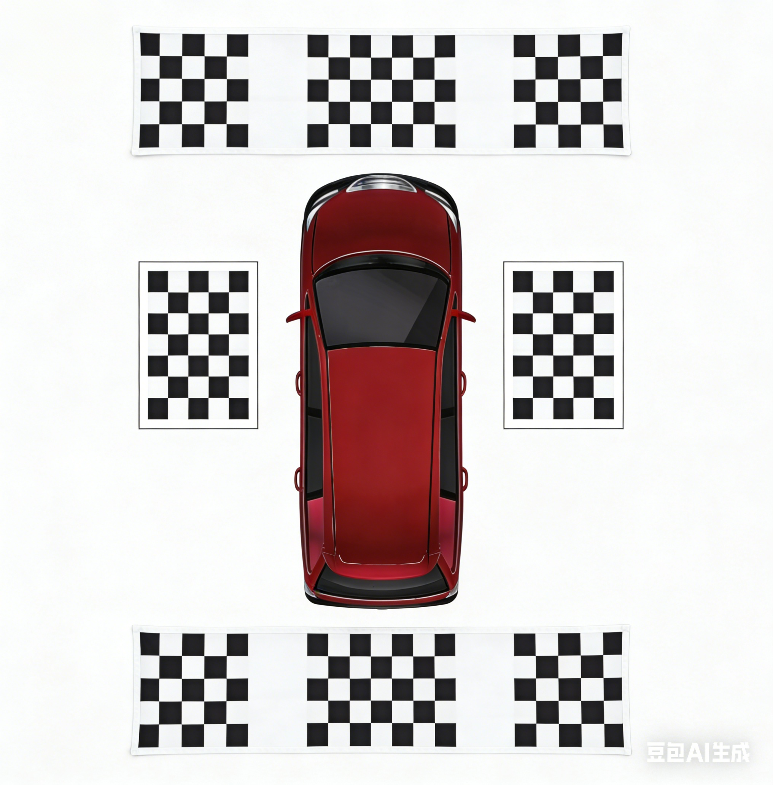

# 环视相机 Roll/Pitch/Yaw 自动标定方案（V2 棋盘格）

> 版本：V2.0  日期：2026-04-01  
> 适用：4路鱼眼/针孔环视相机，安装位置 (x,y,z) 已知精确，roll/pitch/yaw 待标定

---

## 1. 方案概述

### 1.1 已知 / 未知 / 不依赖

| 类别 | 内容 |
|------|------|
| **已知（精确）** | 4个相机在VCS中的安装位置 (x_c, y_c, z_c)；相机内参 K, D；格子尺寸 s=0.2m |
| **待标定** | 每个相机的旋转外参：roll, pitch, yaw（共12个参数） |
| **不依赖** | 标定布到车辆的精确距离；标定布左右偏移量；标定布偏转角（±10°以内自动适应） |

### 1.2 核心思路

```
检测角点(u,v)  +  角点板内3D坐标已知  +  相机平移已知
          ↓
    solvePnP 求初始板位姿
          ↓
  地平面约束联合优化
  [roll, pitch, yaw, x_b, y_b, ψ_b] × N_boards
          ↓
    输出标定旋转 R(roll,pitch,yaw)
          ↓
  由外参(R + 已知T) 直接计算 BEV 单应矩阵
```

**与旧方案的本质区别**：旧方案要求精确输入 `BoardPlacement`（角点VCS坐标），
本方案把标定布位姿作为**待估计的冗余参数**，仅用地面约束，
从而彻底解除对布局测量精度的依赖。

---

## 2. 标定板规格（V2）

### 2.1 前/后板（各1块，共2块）

```
|←————————————— 5.0 m ——————————————→|
+--+——[4×4]——+--+——[6×4]——+--+——[4×4]——+--+
|  |  group1  |  |  group2  |  |  group3  |  |  高 1.2m
+--+——————————+--+——————————+--+——————————+--+
   0.4        1.4  1.8     3.2  3.6      4.6
   (板本地X, 单位m)
```

| 组 | 类型 | 行×列（格子） | 角点数量 | 板内X范围 | 板内Y范围 |
|----|------|--------------|----------|-----------|-----------|
| G1 | 5×5  | 5×5          | 4×4=16   | 0.4~1.4m  | 0.1~1.1m  |
| G2 | 7×5  | 7行×5列       | 6×4=24   | 1.8~3.2m  | 0.1~1.1m  |
| G3 | 5×5  | 5×5          | 4×4=16   | 3.6~4.6m  | 0.1~1.1m  |

> **为何用3组**：前/后相机视角宽，单组棋盘格有角点数量少、覆盖范围窄的问题；
> 3组各自独立检测后联合约束，观测量更充足，且中间 G2（6×4=24 角点）尺寸更大
> 能覆盖图像中心区域，有助于提升 pitch 方向可观测性。

### 2.2 左/右板（各1块，共2块）

```
|← 1.6m →|
+—[4×6]——+   高 1.2m
+—————————+
```

| 组 | 类型 | 行×列（格子） | 角点数量 |
|----|------|--------------|----------|
| G1 | 5×7  | 5行×7列       | 4×6=24   |

---

## 3. 场地要求

### 3.1 场地布置图（俯视）

```
        ←——————— ≥12m ———————→

   ┌──────────────────────────────────┐
   │      ← 5.0m 前板 →              │
   │  [4×4]  [6×4]  [4×4]           │  ↑
   │                                  │
   │  [4×6]   ┌──────┐   [4×6]      │  ≥8m
   │  左板     │  车  │   右板       │
   │           │      │              │  ↓
   │  [4×4]  [6×4]  [4×4]           │
   │      ← 5.0m 后板 →              │
   └──────────────────────────────────┘
```

### 3.2 摆放参数（粗放，无需精确测量）

| 标定布 | 推荐距离 | 允许偏差 | 横向偏心 | 偏转角 |
|--------|----------|----------|----------|--------|
| **前板** | 车头前方 0.5~1.2m | ±0.4m | ±0.5m | ±10° |
| **后板** | 车尾后方 0.3~1.0m | ±0.3m | ±0.5m | ±10° |
| **左板** | 车身左侧 0.3~0.8m | ±0.3m | 纵向±0.5m | ±10° |
| **右板** | 车身右侧 0.3~0.8m | ±0.3m | 纵向±0.5m | ±10° |

> **说明**：上述"允许偏差"是算法自动补偿范围，**操作人员只需目视大致对齐**，
> 无需卷尺精确测量。




### 3.3 硬性场地要求

| 项目 | 要求 | 备注 |
|------|------|------|
| **地面平整度** | 坡度 < 1°（≈17mm/m） | 超过会引入额外 pitch/roll 误差 |
| **场地尺寸** | ≥ 12m × 8m | 容纳车辆 + 4块标定布 |
| **照度** | ≥ 500 lux，均匀 | 避免半边阴影；可室内灯光 |
| **标定布平整** | 翘曲 < 5mm | 展开后四角用重物压住 |
| **无遮挡** | 棋盘格区域完整可见 | 角点缺失超过20%则重放 |
| **车辆静止** | 标定期间不移动 | 触发标定后保持静止 |

---

## 4. 数学原理

### 4.1 坐标系定义

- **VCS**（车辆坐标系）：FLU，原点=后轴中心，X=前，Y=左，Z=上  
- **地面** z_vcs = -z_offset = -0.37m  
- 相机外参：P_cam = R_vc · P_vcs + t_vc，其中 t_vc = -R_vc · p_c

### 4.2 投影模型

已知相机位置 **p_c** = (x_c, y_c, z_c)（精确）。
标定布第 g 组第 (r,c) 个角点在板本地坐标系中：

```
q_i = [ offset_x + c·s,  offset_y + r·s,  0 ]ᵀ
```

其中 (offset_x, offset_y) 为该组在板内的起点坐标（从 chasiss_board_V2.yaml 读取），s=0.2m。

标定板在VCS中的位姿（**自动估计，无需测量**）：

```
板位姿参数：θ_b = (x_b, y_b, ψ_b)
                    ↑     ↑     ↑
                 板中心VCS xy  板偏航角
地面约束：z_b = -z_offset（固定，板在地面上）
```

板本地 → VCS：

```
P_vcs = Rz(ψ_b) · q_i  +  [x_b, y_b, -z_offset]ᵀ
```

VCS → 相机：

```
P_cam = R(roll,pitch,yaw) · (P_vcs - p_c)
```

投影到图像（针孔，畸变前）：

```
(u, v) = π(K, D, P_cam)
```

### 4.3 优化问题

**每个相机**的优化变量：

```
φ = [ roll, pitch, yaw,          ← 3个（待标定）
      x_b¹, y_b¹, ψ_b¹,         ← 每块板3个（冗余参数）
      x_b², y_b², ψ_b²,
      ...                        ]
```

前/后板最多3组棋盘格，共 16+24+16=56 个角点；
左/右板1组，共 24 个角点。

**代价函数**（最小化重投影误差）：

```
E(φ) = Σᵢ ‖ (û_i, v̂_i) - π(K, D, R(φ), p_c, q_i, θ_b) ‖²
```

**自由度分析**（前/后板为例）：
- 观测量：56 角点 × 2 = 112 个方程  
- 未知数：3（相机旋转）+ 3（板位姿） = 6  
- 过约束比：112/6 ≈ 19，充足冗余

### 4.4 求解流程

```
Step 1  初始化
        ├─ 相机旋转：从 params.yaml 的安装参数读取（或全0）
        └─ 板位姿：用初始外参猜测值 + 粗略摆放距离估计初始 x_b,y_b

Step 2  角点检测
        ├─ 去畸变（鱼眼用 fisheye::undistort）
        ├─ findChessboardCorners（每组分别检测）
        └─ cornerSubPix 亚像素精化

Step 3  solvePnP 粗估（每组独立）
        ├─ 输入：q_i（板内3D），(u_i,v_i)（检测2D），K/D
        ├─ 输出：T_cam_board（板在相机系中的位姿）
        └─ 换算出初始 [roll, pitch, yaw, x_b, y_b, ψ_b]

Step 4  Levenberg-Marquardt 细化
        ├─ 联合优化所有参数（相机旋转 + 所有板位姿）
        ├─ 终止条件：Δ残差 < 0.05px 或迭代 > 200 次
        └─ 输出精确 [roll, pitch, yaw]

Step 5  质量评估
        ├─ 重投影误差均值 < 1.5px  → PASS
        └─ 否则 → 警告，提示重新布置

Step 6  计算 BEV 单应矩阵
        └─ calibrateFromExtrinsics()（已有实现）
```

---

## 5. 全自动化标定流程

### 5.1 节点架构

```
┌─────────────────────────────────────────────────────────┐
│                  bev_surround_view_node                   │
│                                                           │
│  /camera_front/image_raw ──┐                             │
│  /camera_rear/image_raw  ──┤                             │
│  /camera_left/image_raw  ──┤→ ImageSync → 标定触发检查   │
│  /camera_right/image_raw ──┘                             │
│                                                           │
│  Service: /bev/trigger_calibration                        │
│    └→ ① 角点检测（4路并行）                               │
│       ② solvePnP 初始化                                   │
│       ③ LM 优化                                           │
│       ④ calibrateFromExtrinsics → BEV 单应矩阵           │
│       ⑤ 保存结果 + 发布 BEV 图像                          │
│                                                           │
│  Service: /bev/reset_calibration                          │
│  Service: /bev/save_calibration                           │
└─────────────────────────────────────────────────────────┘
```

### 5.2 操作步骤

```bash
# 1. 布置标定板（按场地要求大致摆放，无需精确测量）

# 2. 启动标定节点
roslaunch bev_surround_view bev_surround_view_cali.launch

# 3. 检查各相机是否能看到棋盘格（可视化）
rqt_image_view  # 订阅 /bev/detection_vis_* 话题

# 4. 触发标定（一键全自动）
rosservice call /bev/trigger_calibration

# 5. 查看结果
rostopic echo /bev/status          # 标定状态和误差
rqt_image_view /bev/bev_image      # BEV 拼接效果

# 6. 保存
rosservice call /bev/save_calibration
# 结果写入 /tmp/bev_surround_view_calib_result.yaml
```

### 5.3 自检与验收标准

| 指标 | 合格 | 优秀 |
|------|------|------|
| 各相机重投影误差 | < 2.0 px | < 1.0 px |
| BEV 拼接误差 | < 30 mm | < 15 mm |
| 棋盘格角点检测率 | ≥ 80% | 100% |
| 地平面残差（板高度偏差） | < 20 mm | < 10 mm |

---

## 6. 关键设计决策

### 6.1 为何不用单应矩阵直接从棋盘格标定（旧方案）？

旧方案 `calibrate(placements[4])` 要求精确的角点VCS坐标，
即需要事先精确测量标定布位置。
本方案把板位姿作为冗余参数与相机旋转**联合优化**，彻底解耦测量误差。

### 6.2 为何前/后板用3组棋盘格？

- **角点更多**：3组共56角点 vs 单组24角点，过约束更充足
- **横向覆盖更宽**：前相机 FOV 约 180°，3组横向展开 4.6m，充分覆盖边缘畸变区
- **独立可检测性**：每组尺寸小（1m×1m），适合 `findChessboardCorners` 鲁棒检测；
  若一组被遮挡，其他两组仍可用

### 6.3 为何左/右板用单组 5×7？

左右相机 FOV 相对集中，单块1.6m×1.2m的板可覆盖足够视野；
5行×7列=24角点在 yaw 方向提供较好的观测几何。

### 6.4 地平面约束的作用

地平面约束 z_b = -z_offset 将板位姿从6自由度降为3自由度 (x_b, y_b, ψ_b)，
并为 pitch/roll 提供强几何约束（相机看地面时，板的水平性直接反映相机的俯仰/横滚）。

---

## 7. 代码修改规划

基于现有代码结构，需新增/修改以下内容：

### 新增模块

| 文件 | 作用 |
|------|------|
| `include/bev_surround_view/extrinsic_solver.h` | PnP初始化 + LM优化，输出 roll/pitch/yaw |
| `src/extrinsic_solver.cpp` | 实现上述求解器 |
| `config/chasiss_board_V2.yaml` | 已有，直接读取 |

### 修改模块

| 文件 | 修改内容 |
|------|---------|
| `src/bev_surround_view_node.cpp` | 读取安装参数(x,y,z)，调用 ExtrinsicSolver，再调用已有 calibrateFromExtrinsics() |
| `config/params.yaml` | 增加 `installation` 节（4相机的 x,y,z + roll/pitch/yaw 初始值） |

### 数据流

```
params.yaml (x,y,z + RPY初值)
        +
chasiss_board_V2.yaml (角点3D坐标)
        +
camera images (检测角点2D)
        ↓
ExtrinsicSolver::solve()  →  CameraExtrinsic[4]  →  calibrateFromExtrinsics()  →  H[4]
```

---

## 8. 典型误差分析

| 误差来源 | 对结果影响 | 缓解措施 |
|----------|----------|----------|
| 地面不平（坡度0.5°） | roll/pitch 偏差 ~0.5° | 选平整地面；可多次标定取均值 |
| 标定布翘曲（5mm） | 重投影误差 ~0.5px | 四角压重物 |
| 棋盘格角点漏检 | 约束减少，精度下降 | 改善光照；要求检测率>80% |
| 相机位置误差（5mm） | yaw偏差 ~0.1°（在2m距离时） | 安装后精确测量 x,y,z |
| 鱼眼畸变模型误差 | 边缘区域重投影偏大 | 先用高精度内参标定 |
